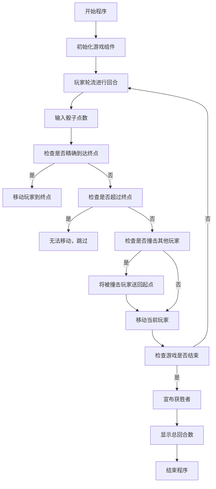

# Simple Frustration 棋盘游戏

## 项目概述
这是一个基于Java的控制台应用程序，模拟了名为"Simple Frustration"的棋盘游戏。游戏支持两名玩家轮流掷骰子，率先到达终点者获胜。

## 关键类及其职责说明

### Main 类
- **职责**: 程序入口点，负责初始化游戏并启动
- **主要方法**: `main()` - 创建游戏实例并开始游戏

### Game 类
- **职责**: 管理游戏的核心逻辑和流程
- **主要方法**:
  - `play()`: 游戏主循环
  - `getDiceRoll()`: 获取玩家输入的骰子点数
  - `movePlayer()`: 根据骰子点数移动玩家并处理游戏规则

### Board 类
- **职责**: 定义棋盘的属性和规则
- **主要属性**:
  - `BOARD_SIZE`: 棋盘大小（36格）
  - `FINISH_POSITION`: 终点位置
- **主要方法**:
  - `getFinishPosition()`: 返回终点位置
  - `isAtFinish()`: 检查是否到达终点
  - `isValidPosition()`: 验证位置是否有效

### Player 类
- **职责**: 表示玩家实体，管理玩家状态
- **主要属性**:
  - `playerId`: 玩家ID
  - `position`: 当前位置
  - `roundCount`: 已进行的回合数
- **主要方法**:
  - `get/setPosition()`: 获取/设置玩家位置
  - `incrementRoundCount()`: 增加回合计数

## 程序执行流程说明



## 实现的变体和高级功能

### 1. 精确终点获胜
- **说明**: 玩家必须掷出恰好到达终点的点数，否则无法移动
- **实现**: 在`Game.movePlayer()`方法中检查新位置是否超过终点

### 2. 被撞击返回起点
- **说明**: 如果一个玩家移动到另一个玩家所在的格子，被撞击的玩家将返回起点
- **实现**: 在`Game.movePlayer()`方法中检测玩家位置重叠，并将被撞击玩家的位置重置为0

### 3. 大棋盘
- **说明**: 使用36格的大棋盘，而不是标准的18格棋盘
- **实现**: 在`Board`类中设置`BOARD_SIZE = 36`

### 4. 格子被占领不可进入的变种规则
- **说明**: 如果一个格子已经被另一个玩家占据，则当前玩家无法移动到该格子（除了起点和终点）
- **实现**: 通过位置重叠检测实现

## 使用的设计模式及其应用场景

### 1. 单一职责原则
- **应用**: 每个类都有明确的单一职责
  - `Game`: 游戏逻辑
  - `Board`: 棋盘规则
  - `Player`: 玩家状态

### 2. 面向对象设计
- **应用**: 使用类来封装数据和行为
  - 玩家的状态和行为封装在`Player`类中
  - 棋盘的属性和规则封装在`Board`类中

### 3. 组合模式
- **应用**: `Game`类组合了`Board`和`Player`对象，形成完整的游戏系统

## 游戏规则摘要

1. 两名玩家轮流掷骰子（输入1-6之间的整数）
2. 玩家根据骰子点数移动
3. 若移动后超过终点，则无法移动
4. 若移动到另一个玩家所在格子（非终点），则被撞击的玩家返回起点
5. 率先精确到达终点的玩家获胜

## 如何运行游戏

1. 确保已安装Java开发环境（JDK）
2. 编译源代码：
   ```
   javac -d bin src/Main.java src/com/frustration/*.java
   ```
3. 运行程序：
   ```
   java -cp bin Main
   ```
4. 按照控制台提示进行游戏